<a href="https://www.qebalah.dev/">
  
</a>

<p align="center">
  <a href="https://www.qebalah.dev/"></a>
  <a href="https://www.linkedin.com/in/mohammad-qebalah-4b6a30175"></a>
  <a href="https://x.com/MoahmmadAhamd"></a>
  <a href="mailto:mohammad.qb@qblab.co"></a>
</p>

<br/>

I'm a full-stack engineer who has led engineering teams and takes products from **idea → MVP → production → scale**. Lately that means **AI products** (agents, RAG pipelines, LLM integrations — including Sentry agents that open their own pull requests), **production mobile apps** with React Native & Expo, and **backends that hold up under real users**.

<br/>



<br/>

## ⌁ Featured work

<table>
  <tr>
    <td width="50%"><a href="https://askedgar.io"></a></td>
    <td width="50%"><a href="https://getzadi.com"></a></td>
  </tr>
  <tr>
    <td width="50%"><a href="https://nafsihealth.com"></a></td>
    <td width="50%"><a href="https://iconec.co"></a></td>
  </tr>
</table>

## ⌁ Stack

| | |
|---|---|
| **Mobile & Web** |  &nbsp; `Expo` `EAS` `NativeWind` `Gluestack` |
| **Backend & Data** |  |
| **Cloud & DevOps** |  |
| **AI** |  &nbsp; `LangChain` `RAG` `Embeddings` `Autonomous agents` `OpenAI` `Claude` |
| **Side quests** |  &nbsp; building games with my team 🎮 |

## ⌁ Activity

<p align="center">
  
  
</p>

<p align="center">
  <picture>
    <source media="(prefers-color-scheme: dark)" srcset="https://raw.githubusercontent.com/mohammad-qb/mohammad-qb/output/snake-dark.svg" />
    
  </picture>
</p>

## ⌁ Let's build something

```diff
+ Open to:  Lead / Staff / Head-of-Engineering roles · founding engineer · consulting via QB Lab
+ Where:    Dubai · remote · global
+ Reach me: mohammad.qb@qblab.co
```
